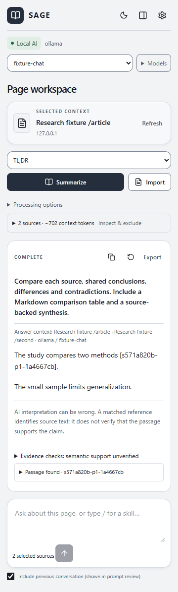
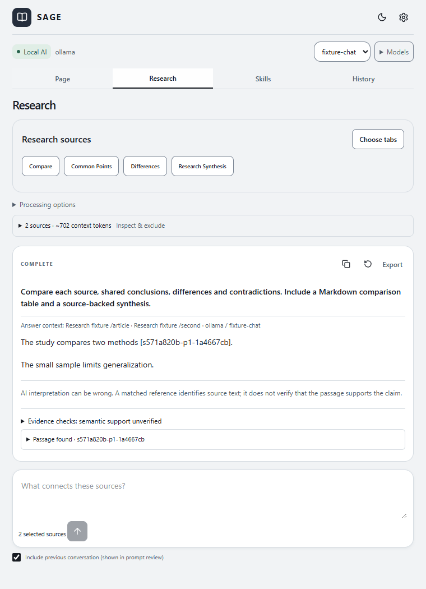
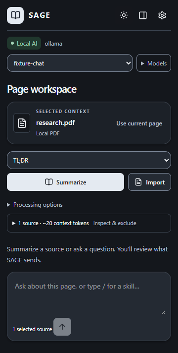
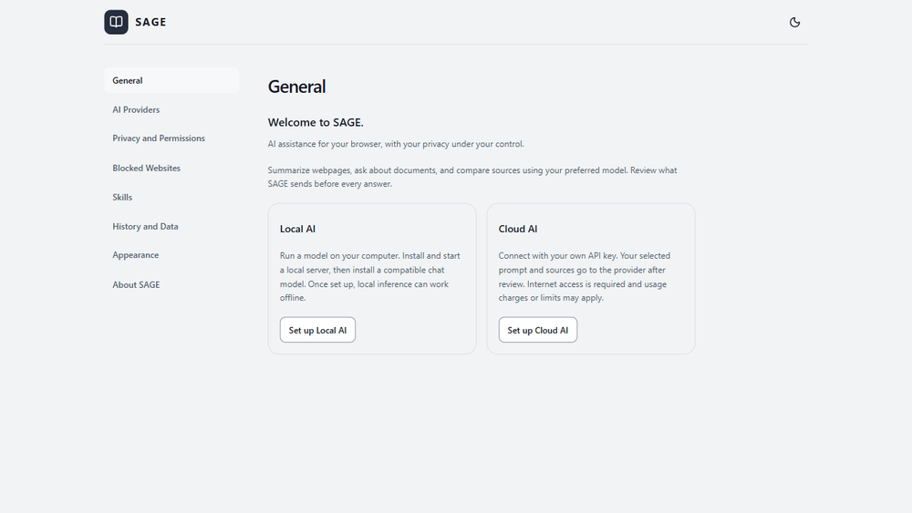
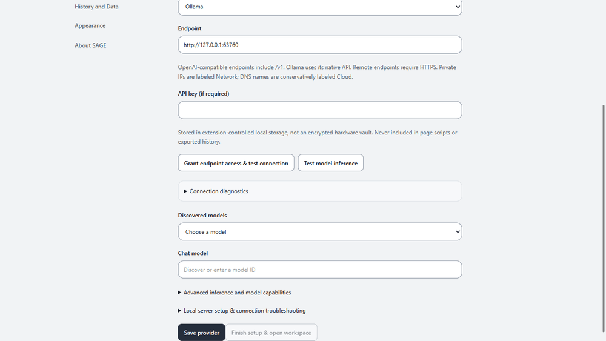
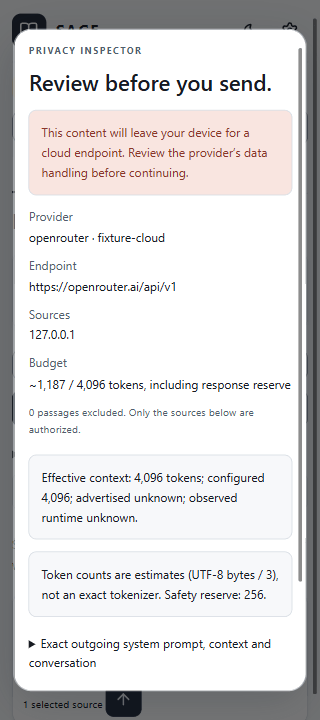
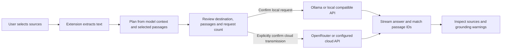

# SAGE

**Your Private AI Research Companion**

  [](LICENSE) 

SAGE is a privacy-first, model-agnostic browser extension for reading webpages, comparing tabs and asking questions about documents. It runs inside Helium or compatible Chromium browsers and connects to an AI provider you choose.

## Why SAGE?

Research often means copying text between tabs and chat tools, then retracing which source supported an answer. SAGE keeps selected sources and original passages alongside the answer. Before sending a request, you can inspect its destination and context, exclude passages, and decide whether to proceed.

For students and developers, this makes a research session easier to review or export. For local AI users, it puts the browser interface next to a model they already control. Model answers still need source review.

## What you can do

| Capability              | In SAGE                                                                                     |
| ----------------------- | ------------------------------------------------------------------------------------------- |
| Webpages and selections | Summarize permitted pages, ask follow-up questions and explain selected text.               |
| Research across tabs    | Compare selected sources and inspect original passages.                                     |
| Documents               | Import text PDFs and DOCX files. Larger selections can use reviewed, resumable batch plans. |
| Providers               | Discover and switch models on Ollama, OpenRouter and compatible endpoints.                  |
| Research tools          | Reuse prompts with Skills, keep optional history and export answers.                        |
| Privacy controls        | Review requests, exclude passages, block domains and revoke optional access.                |

See the [feature matrix](docs/FEATURE_MATRIX.md) for verification scope.

## Screenshots

Captured from the packaged extension with synthetic sources.

| Popup                                                                                   | Research workspace                                                                      | Dark theme                                                                        |
| --------------------------------------------------------------------------------------- | --------------------------------------------------------------------------------------- | --------------------------------------------------------------------------------- |
|  |  |  |

| Onboarding                                                                    | Model setup                                                                      | Cloud request review                                                                           |
| ----------------------------------------------------------------------------- | -------------------------------------------------------------------------------- | ---------------------------------------------------------------------------------------------- |
|  |  |  |

See the [product audit and screenshot gallery](docs/PRODUCT_AUDIT.md) for privacy settings, history, error recovery, and a long-answer rendering fixture.

## How SAGE works



The background worker runs extraction, request policy and caching. The planner selects one request or a reviewed batch sequence using the configured context and output budget. Citation checks resolve passage IDs. They do not establish whether a passage supports the model's claim. [Architecture](docs/ARCHITECTURE.md)

## Install

Use a desktop Chromium browser that supports Manifest V3 and permits unpacked extensions. Helium is the primary target. Edge and Brave have been exercised in browser tests. See the [verification report](docs/RELEASE_VERIFICATION.md) for versions and platform scope.

1. Download the 0.1.3 ZIP and checksum from the [release page](https://github.com/PraneshS19/SAGE/releases) once the maintainer publishes the assets. Until then, build it using the commands below.
2. Extract the ZIP, open `chrome://extensions` (or your browser's extension manager), and enable **Developer mode**.
3. Choose **Load unpacked** and select the folder containing `manifest.json`.
4. Open SAGE from the extensions menu, choose **Get Started**, and select Local AI or Cloud AI.

The unpacked extension needs no Node.js, npm or development server. When upgrading, replace files in the existing loaded directory and reload the same browser entry. [Installation and updates](docs/INSTALL.md)

### Local AI

[Install Ollama](https://ollama.com/download), start its server, and choose a chat model. For example, `ollama pull phi3:3.8b` downloads one model used in testing. In SAGE, choose **Local AI**, grant access to `http://127.0.0.1:11434`, discover and select a model, and test the connection. If Ollama rejects the extension origin, copy the origin shown by your own installation and add it to the server's allowlist. [Provider setup](docs/PROVIDERS.md) · [Troubleshooting](docs/TROUBLESHOOTING.md)

### Cloud AI

Choose **Cloud AI**, enter your OpenRouter API key, grant the exact provider origin, and select a chat model. Confirm each request after reviewing its context. The configured provider receives the selected text and prompt and may retain them. Usage can incur charges or rate limits. [Quick start](docs/QUICK_START.md)

### Model compatibility

SAGE accepts compatible chat model IDs and uses their configured serving limits. Phi-3 and Qwen have live evaluation evidence. Other families such as Llama, Gemma and GPT-OSS may be used through a compatible deployment. Smaller contexts may need more batches. Larger ones can fit more source text per request, and their answers still need checking. [Model architecture](docs/MODEL_ARCHITECTURE.md)

## Privacy and security

SAGE has no required account or hosted SAGE backend. Local inference can work offline after the server and model are installed. The extension has no default host grants. It requests access when needed, keeps API keys in trusted extension storage, and leaves history and restart checkpoints off by default. Domain blocking and the request inspector help control what is included. Browser storage is not an encrypted vault. [Privacy](docs/PRIVACY.md) · [Security and vulnerability reporting](SECURITY.md)

## Technology stack

| Layer       | Implementation                                                                                                                                |
| ----------- | --------------------------------------------------------------------------------------------------------------------------------------------- |
| Extension   | WXT builds the Chromium Manifest V3 bundle. Browser APIs handle tabs, permissions, messaging and extension storage.                           |
| Interface   | React, TypeScript, Tailwind CSS and Lucide icons.                                                                                             |
| Inference   | Native Ollama and OpenAI-compatible adapters, including OpenRouter.                                                                           |
| Content     | Mozilla Readability and Turndown for pages, PDF.js for text PDFs, fflate and XML parsing for DOCX, React Markdown and remark-gfm for answers. |
| Development | Node.js 24, npm, ESLint, Vitest, Playwright and GitHub Actions.                                                                               |

## Develop and contribute

```sh
git clone https://github.com/PraneshS19/SAGE.git
cd SAGE
npm ci
npm run dev
```

Run `npm run typecheck`, `npm run lint` and `npm test` for static and deterministic checks. Run `npm run release` to build and verify the production ZIP in `dist/SAGE-0.1.3`. Install Playwright Chromium with `npx playwright install chromium` before `npm run test:e2e`. Set `SAGE_BROWSER` to a browser executable if testing an installed browser. [Development guide](docs/DEVELOPMENT.md) · [Contributing](CONTRIBUTING.md)

```text
src/       Extension entrypoints, components, processing and provider adapters
public/    Runtime icons and notices
tests/     Unit, integration and browser tests with synthetic fixtures
scripts/   Release and live verification tools
docs/      User guides, architecture and verification evidence
.github/   CI and contributor templates
```

## Verification and limits

See [publication checks](docs/PUBLICATION.md) for the fresh run and [0.1.3 release evidence](docs/RELEASE_VERIFICATION.md) for the prior milestone. Deterministic browser tests use controlled providers. Live Ollama and model-quality trials are reported separately. Live cloud inference has not been verified.

SAGE remains **Functional Alpha**. Long-document completion, factual accuracy and citations vary with the model and document. Text PDFs are supported, while scanned PDFs need OCR elsewhere. Native browser controls vary across Chromium distributions. macOS and Linux have not been independently verified. [Known limitations](docs/KNOWN_LIMITATIONS.md)

Priorities are factual grounding, more reliable long-document synthesis, provider and platform coverage, and eventual browser-store distribution. [Changelog](CHANGELOG.md)

Maintained in [PraneshS19/SAGE](https://github.com/PraneshS19/SAGE). Apache-2.0. [License](LICENSE) · [Dependency notices](docs/DEPENDENCIES.md)
